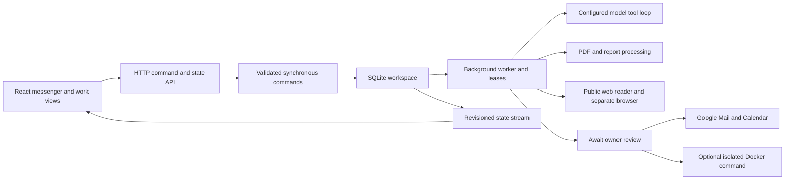

# Architecture

Relay shares a command and domain layer between its browser sample and its own server. There is no upstream assistant framework or source subtree.

- `shared/`: independently authored commands, state fixtures, cent-based finance, PDF utilities, and task steps. Commands are synchronous so validation failures can roll back atomically.
- `server/store.mjs`: SQLite WAL with one owner workspace, a secrets table, and hashed access sessions. Persisted state has an increasing revision.
- `server/worker.mjs`: claims work atomically, limits concurrency, orders turns in the same conversation, renews leases, discards late output after cancellation, and recovers interrupted work after restart. An interrupted external write is marked unknown instead of sent again automatically.
- `server/agent.mjs` and `model.mjs`: bounded tool loop and streaming adapters. Responses output items, including encrypted reasoning, are passed back in order; Chat Completions tool fragments are assembled from SSE. Tools prepare reviews; the model has no approval-execution tool.
- `server/google.mjs`: PKCE/state-bound OAuth, encrypted tokens, bounded sync, provider IDs and ETags, immutable MIME attachments, and explicit unknown-write outcomes.
- `server/network.mjs`: destination validation, public IPv4 DNS checks, pinned connection address, redirect revalidation, timeout and response caps. It prevents access to private addresses through the browser/reader.
- `server/browser.mjs`: a separate Playwright profile. Network requests pass through the public-destination reader. POST and other write requests are blocked. This is not a hardened VM and should be deployed under a restricted OS account.
- `server/terminal.mjs`: optional Docker execution without a host shell or host mounts. It validates container isolation before reusing a container and applies non-root, read-only root, offline network, and resource/output limits.
- `src/api.ts`: revision-aware server updates or IndexedDB sample state. The sample worker shares domain logic and uses local fixture behavior only.
- `src/components/Assistant.tsx`: identity/status, activity/access inspection, editable memories, and provenance links. `Search.tsx` searches owned workspace state. `views/Chat.tsx` renders the primary messenger.
- `src/webmcp.ts`: registers browser tools only when supported; validates inputs and reuses commands rather than maintaining a second implementation.

## Action review invariant

A review records the exact recipient, subject, body, account generation, expiry, and attachment bytes. A calendar review records provider identity and version. A single owner decision makes an action eligible for a worker claim. The worker validates it again and executes once. The preview renders the review snapshot, not a mutable workspace file. Declined, expired, cancelled, stale-account, and stale-calendar actions do not execute.

## Deployment boundary

Static hosting serves the sample frontend. Real integrations need the Node service. The app is single-owner and is not a multi-tenant service. It binds loopback by default; remote access requires an access key and deployment behind HTTPS. Back up the state directory while the service is stopped. OAuth token decryption also requires preserving the owner's encryption key outside that backup.
